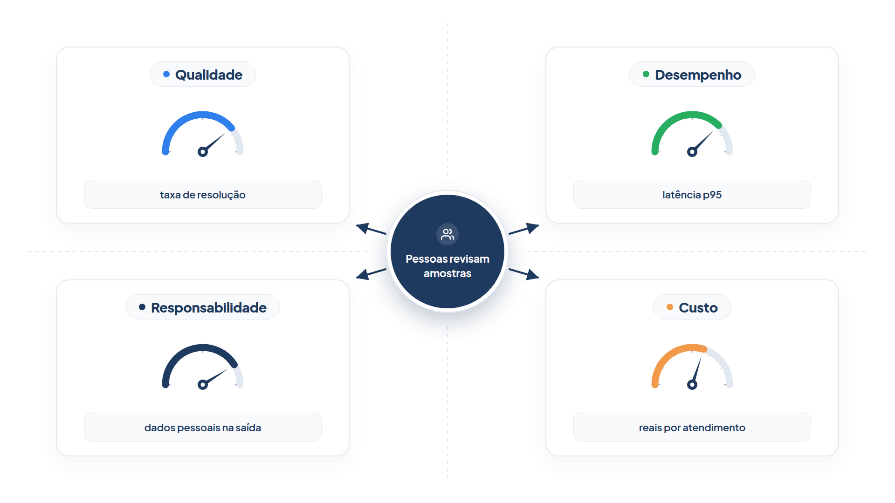

# Capítulo 36 — Avaliação em produção

No Módulo 9, você avaliou o agente antes de lançá-lo, com tarefas controladas. Em produção, o cenário é outro: as perguntas são as que os clientes realmente fazem, não há gabarito para a maioria delas, e o agente pode piorar sem que ninguém mude uma linha de código, por uma atualização do modelo, uma ferramenta que passou a falhar ou uma mudança no comportamento dos clientes. Este capítulo monta o acompanhamento contínuo: um painel com quatro dimensões, alertas e um ciclo que leva as falhas reais de volta ao seu conjunto de avaliação.



> **Antes de começar — PydanticAI neste capítulo**
>
> Este capítulo não cria agentes: ele mede um agente que já roda. Você usa `@dataclass` e a anotação `bool | None`, vistos no [Capítulo 0.2](../modulo-00/0.2-o-python-que-o-livro-assume.md), e o `Case` do `pydantic-evals` (Capítulo 30), que é um modelo do Pydantic como os do [Capítulo 0.3](../modulo-00/0.3-pydantic-na-pratica.md).

## Quatro dimensões

A Amazon descreveu o framework de avaliação que usa para os seus agentes. Ele nasce de uma constatação: os métodos tradicionais de avaliação de modelos tratam os sistemas de agentes como caixas-pretas e avaliam só o resultado final, sem explicar *por que* os agentes falham. O framework avalia o sistema em quatro dimensões, que devem ser consideradas de forma equilibrada:

- **Qualidade:** a coerência do raciocínio, a precisão na seleção de ferramentas e as taxas de sucesso na conclusão de tarefas.
- **Desempenho:** a latência, a vazão e o uso de recursos sob carga.
- **Responsabilidade:** segurança e toxicidade, mitigação de vieses, detecção de alucinações e conformidade com as políticas da organização.
- **Custo:** custos diretos (inferência do modelo, chamadas de ferramenta, processamento de dados) e indiretos (esforço humano, correção de erros).

A biblioteca de avaliação da Amazon é organizada em três camadas: a inferior avalia os modelos de base; a intermediária avalia componentes (detecção de intenção, conversas de vários turnos, memória, raciocínio e uso de ferramentas); a superior avalia a resposta final e a conclusão da tarefa. Entre as métricas estão a correção, a fidelidade, a utilidade, a relevância e a concisão da resposta final; o sucesso e a acurácia do objetivo; a precisão da seleção de ferramentas, a dos parâmetros e a taxa de erro das chamadas; a recuperação de contexto da memória; a aderência ao tema; e a alucinação, a toxicidade e a nocividade. Muitas você já conhece: são as lentes do Módulo 9, agora em produção.

Duas lições do framework merecem destaque. Primeiro, além das métricas padronizadas, **inclua métricas específicas do caso de uso**, como a satisfação do cliente, a taxa de resolução no primeiro contato e a análise de sentimento. Segundo, a **avaliação com pessoas** é indispensável, em especial nas decisões de alto risco: para avaliar cadeias de raciocínio, a coerência de fluxos de várias etapas e o alinhamento com os requisitos do negócio, para fornecer os rótulos de referência dos conjuntos de teste e para calibrar os juízes baseados em modelos.

## O que se guarda de cada atendimento

Para acompanhar as quatro dimensões, cada atendimento deixa um **registro** com os números que interessam, e nada além. Seguimos a lição do Capítulo 34: estrutura, não conteúdo.

*producao.py*

```python
import random
import statistics
from dataclasses import dataclass


@dataclass
class Registro:
    """O que se guarda de cada atendimento em produção (sem o conteúdo da conversa)."""

    id: str
    resolveu: bool | None  # None: ainda sem rótulo
    latencia_s: float
    tokens: int
    guardrail_acionado: bool
    dado_pessoal_na_saida: bool
    escalou_para_humano: bool


CUSTO_POR_MIL_TOKENS = 0.02  # valor hipotético, em reais


def gerar_registros(n: int, semente: int, taxa_de_resolucao: float = 0.85, lentidao: float = 1.0) -> list[Registro]:
    sorteio = random.Random(semente)
    registros = []
    for i in range(n):
        registros.append(Registro(
            id=f"a{semente}-{i}",
            resolveu=sorteio.random() < taxa_de_resolucao,
            latencia_s=max(0.3, sorteio.gauss(2.0 * lentidao, 0.5)),
            tokens=int(sorteio.gauss(1800, 300)),
            guardrail_acionado=sorteio.random() < 0.03,
            dado_pessoal_na_saida=sorteio.random() < 0.002,
            escalou_para_humano=sorteio.random() < 0.08,
        ))
    return registros


def percentil(valores: list[float], p: float) -> float:
    ordenados = sorted(valores)
    return ordenados[min(len(ordenados) - 1, int(p * len(ordenados)))]


def painel(registros: list[Registro]) -> dict[str, float]:
    n = len(registros)
    rotulados = [r for r in registros if r.resolveu is not None]
    return {
        "qualidade: taxa de resolução": sum(r.resolveu for r in rotulados) / len(rotulados),
        "desempenho: latência p50 (s)": percentil([r.latencia_s for r in registros], 0.50),
        "desempenho: latência p95 (s)": percentil([r.latencia_s for r in registros], 0.95),
        "responsabilidade: guardrails acionados": sum(r.guardrail_acionado for r in registros) / n,
        "responsabilidade: dado pessoal na saída": sum(r.dado_pessoal_na_saida for r in registros) / n,
        "custo: R$ por atendimento": statistics.mean(r.tokens for r in registros) / 1000 * CUSTO_POR_MIL_TOKENS,
        "supervisão: escalonamentos para humano": sum(r.escalou_para_humano for r in registros) / n,
    }
```

O `Registro` guarda, por atendimento, um identificador, se resolveu (`None` quando ainda não há rótulo: em produção, a maioria dos atendimentos não tem gabarito), a latência, os tokens, e três sinais de segurança: se um guardrail foi acionado, se um dado pessoal apareceu na saída e se houve escalonamento para uma pessoa.

### Por que `Registro` é um `dataclass`, e não um `BaseModel`

O `Registro` usa `@dataclass` porque é só um pacote de números que o seu próprio código preenche. Um `dataclass` **não confere os tipos**: as anotações são só documentação. Um `BaseModel` do Pydantic confere os valores ao criar o objeto. Compare os dois com o mesmo dado errado:

*registro_validado.py*

```python
from dataclasses import dataclass

from pydantic import BaseModel, ValidationError


@dataclass
class RegistroSimples:
    id: str
    latencia_s: float


class RegistroValidado(BaseModel):
    id: str
    latencia_s: float


simples = RegistroSimples(id="a1-0", latencia_s="rápido")
print("dataclass aceitou:", simples.latencia_s)

try:
    RegistroValidado(id="a1-0", latencia_s="rápido")
except ValidationError as erro:
    print("BaseModel recusou:", erro.errors()[0]["msg"])
```

Saída:

```text
dataclass aceitou: rápido
BaseModel recusou: Input should be a valid number, unable to parse string as a number
```

O `dataclass` guardou a palavra "rápido" como latência, e o erro só apareceria depois, na hora de somar. Aqui isso é aceitável, porque os registros nascem do seu código. Se eles viessem de fora, como um arquivo de rastro de outro sistema, valeria trocar por `BaseModel` para recusar o dado ruim na entrada.

A função `gerar_registros` cria registros fictícios com uma semente fixa, para que as saídas sejam reproduzíveis; em produção, eles vêm dos rastros do Capítulo 34. A função `painel` agrega os registros em uma métrica por linha, uma ou mais para cada dimensão: a taxa de resolução (qualidade); a latência mediana e o percentil 95 (desempenho); a taxa de guardrails acionados e de dados pessoais na saída (responsabilidade); o custo em reais por atendimento; e a taxa de escalonamentos (supervisão).

A latência é resumida por *percentis*, e não pela média: o p95 diz "95% dos atendimentos foram mais rápidos que isto", e revela a cauda lenta que a média esconde.

Compare dois dias: ontem, com o agente funcionando normalmente, e hoje, com uma taxa de resolução menor e respostas mais lentas.

*producao_demo.py*

```python
from producao import gerar_registros, painel

ontem = painel(gerar_registros(1000, semente=1))
hoje = painel(gerar_registros(1000, semente=2, taxa_de_resolucao=0.78, lentidao=1.6))

print(f"{'métrica':44s} {'ontem':>8s} {'hoje':>8s}")
for nome in ontem:
    print(f"{nome:44s} {ontem[nome]:8.3f} {hoje[nome]:8.3f}")
```

Saída:

```text
métrica                                         ontem     hoje
qualidade: taxa de resolução                    0.844    0.769
desempenho: latência p50 (s)                    2.015    3.206
desempenho: latência p95 (s)                    2.814    4.025
responsabilidade: guardrails acionados          0.032    0.035
responsabilidade: dado pessoal na saída         0.001    0.001
custo: R$ por atendimento                       0.036    0.036
supervisão: escalonamentos para humano          0.085    0.085
```

O painel mostra, de relance, *o que* mudou: a qualidade caiu de 84% para 77% e a latência subiu de 2,0 para 3,2 segundos no p50. Segurança, custo e escalonamentos ficaram estáveis. Isso já orienta a investigação: algo afetou a qualidade e o desempenho, mas não a segurança. Como a mudança foi de qualidade *e* de latência, uma causa plausível é uma ferramenta lenta que passou a falhar. O rastro de uma amostra dos atendimentos de hoje diria qual.

## Alertas

Um painel só ajuda se alguém olhar para ele. Um **alerta** observa a métrica e avisa quando ela passa de um limite. Os limites são decisões suas, de preferência baseadas no que a avaliação mostrou ser aceitável:

*alertas.py*

```python
LIMITES = {
    "qualidade: taxa de resolução": ("minimo", 0.80),
    "desempenho: latência p95 (s)": ("maximo", 3.5),
    "responsabilidade: dado pessoal na saída": ("maximo", 0.005),
    "custo: R$ por atendimento": ("maximo", 0.05),
}


def conferir(metricas: dict[str, float]) -> list[str]:
    avisos = []
    for nome, (tipo, limite) in LIMITES.items():
        valor = metricas[nome]
        if (tipo == "minimo" and valor < limite) or (tipo == "maximo" and valor > limite):
            avisos.append(f"ALERTA {nome}: {valor:.3f} ({'abaixo' if tipo == 'minimo' else 'acima'} de {limite})")
    return avisos
```

*alertas_demo.py*

```python
from alertas import conferir
from producao import gerar_registros, painel

for titulo, registros in {
    "ontem": gerar_registros(1000, semente=1),
    "hoje": gerar_registros(1000, semente=2, taxa_de_resolucao=0.78, lentidao=1.6),
}.items():
    avisos = conferir(painel(registros))
    print(f"{titulo}:", "sem alertas" if not avisos else f"{len(avisos)} alerta(s)")
    for aviso in avisos:
        print("  ", aviso)
```

Saída:

```text
ontem: sem alertas
hoje: 2 alerta(s)
   ALERTA qualidade: taxa de resolução: 0.769 (abaixo de 0.8)
   ALERTA desempenho: latência p95 (s): 4.025 (acima de 3.5)
```

Ontem, tudo dentro dos limites. Hoje, dois alertas, e a equipe é avisada na hora, e não quando um cliente reclama. Há dois tipos de limite no exemplo: mínimos (a qualidade não pode cair abaixo de 80%) e máximos (a latência, os dados pessoais e o custo não podem passar de um teto).

O guia da Amazon menciona o complemento: a **detecção automática de anomalias**, que compara uma métrica com o seu comportamento habitual, em vez de usar um limite fixo, e é útil quando você não sabe de antemão qual é o valor "normal".

> **Nota:** Todo alerta custa atenção. Alertas demais, ou mal calibrados, ensinam a equipe a ignorá-los. Comece com poucos, nos pontos em que um problema seria grave, e ajuste os limites com a experiência.

### Faça você mesmo

- **36.1 Um novo alerta:** acrescente um alerta para a taxa de escalonamentos acima de 12%. Gere um dia com mais escalonamentos e confira o disparo.
- **36.2 Limites do seu agente:** escolha um limite para cada dimensão do atendimento da Casa Verde e justifique cada um com um dado: de onde vem o número?
- **36.3 Dois dias lado a lado:** gere um terceiro dia, `semente=3`, com custo 50% maior (ajuste `tokens` na função), e descreva em quais métricas e alertas isso aparece.
- **36.4 Anomalia simples:** escreva uma função que avise quando o valor de hoje se afastar mais de três desvios-padrão da média dos últimos sete dias.

## Pessoas no ciclo, outra vez

Os números dizem *que* algo mudou, mas só a leitura de atendimentos reais diz *o quê*. A Amazon aponta o papel indispensável das pessoas na avaliação em produção. Na prática, isso é uma **fila de revisão**: uma amostra dos atendimentos, escolhida para dar o máximo de informação, que pessoas leem e classificam.

Uma boa amostra combina dois tipos: os casos **suspeitos**, em que um sinal automático levantou uma suspeita (escalonamento, guardrail acionado, dado pessoal na saída), e uma pequena parte **aleatória** dos demais, para pegar os problemas que nenhum sinal viu. O ciclo se fecha quando uma falha confirmada vira uma tarefa do conjunto de avaliação do Capítulo 30.

*revisao.py*

```python
import random

from pydantic_evals import Case

from producao import Registro, gerar_registros


def amostra_para_revisao(registros: list[Registro], fracao: float = 0.02, semente: int = 7) -> list[Registro]:
    """Todos os casos suspeitos mais uma amostra aleatória dos demais."""
    suspeitos = [
        r for r in registros
        if r.escalou_para_humano or r.guardrail_acionado or r.dado_pessoal_na_saida
    ]
    ids_suspeitos = {r.id for r in suspeitos}
    restantes = [r for r in registros if r.id not in ids_suspeitos]
    sorteio = random.Random(semente)
    aleatorios = sorteio.sample(restantes, k=int(len(restantes) * fracao))
    return suspeitos + aleatorios


def virar_caso(registro: Registro, conversa: str, esperado: str) -> Case:
    """Uma falha confirmada por uma pessoa vira uma tarefa do conjunto de avaliação."""
    return Case(name=f"produção {registro.id}", inputs=conversa, expected_output=esperado)


if __name__ == "__main__":
    registros = gerar_registros(1000, semente=2, taxa_de_resolucao=0.78)
    fila = amostra_para_revisao(registros)
    falhas = [r for r in registros if r.resolveu is False]
    print(f"Atendimentos: {len(registros)}")
    print(f"Casos na fila de revisão (suspeitos e amostra): {len(fila)}")
    print(f"Fila como fração do total: {len(fila) / len(registros):.0%}")

    caso = virar_caso(falhas[0], "Posso cancelar o pedido 1001?", "não")
    print("\nNovo caso do conjunto:", caso.name, "|", caso.inputs, "->", caso.expected_output)
```

Saída:

```text
Atendimentos: 1000
Casos na fila de revisão (suspeitos e amostra): 134
Fila como fração do total: 13%

Novo caso do conjunto: produção a2-0 | Posso cancelar o pedido 1001? -> não
```

A fila de 134 atendimentos, 13% do total, é a sua economia de atenção: em vez de ler mil conversas, as pessoas leem as 134 que mais tendem a ensinar algo. A função `virar_caso` fecha o ciclo: a conversa e o resultado esperado, definido por quem revisou, viram um `Case` do `pydantic-evals`, que a bancada passa a executar a cada mudança. Uma falha de produção que se repete vira uma regressão que o portão do Capítulo 33 impede.

Esse é o circuito completo de melhoria contínua, que o guia da Amazon descreve como avaliação contínua em produção: **painéis operacionais, detecção de anomalias, laços de retorno e, quando a degradação aparece, ajustes** nos prompts, nas ferramentas ou nos modelos. O ciclo automatizado, nas palavras da Amazon, tem quatro etapas: definir as entradas (arquivos de rastro), gerar as métricas, compartilhá-las em um painel e analisá-las por auditoria e monitoramento contínuo. É o que você montou.

### Faça você mesmo

- **36.5 Revisão semanal:** descreva, em cinco linhas, a rotina semanal de revisão do atendente: quem revisa, quantos casos, como classifica e para onde vão os resultados.
- **36.6 Fila menor:** altere `fracao` e a definição de suspeitos para que a fila fique abaixo de 8% sem perder os casos de dado pessoal e de guardrail. Que risco isso traz?
- **36.7 Rótulos atrasados:** em produção, `resolveu` só é conhecido dias depois (pela pesquisa de satisfação). Explique o que isso significa para a janela de tempo do painel de qualidade e para os alertas.
- **36.8 De falha a regressão:** escolha uma falha do conjunto do Capítulo 30 e descreva o caminho completo, da reclamação do cliente até o portão de regressão.

## Recapitulando

Você agora acompanha o agente em produção com as quatro dimensões do framework da Amazon: qualidade, desempenho, responsabilidade e custo, mais a taxa de escalonamentos como medida da supervisão. Construiu um painel de métricas agregadas (com percentis para a latência), alertas com limites mínimos e máximos, e uma fila de revisão que combina casos suspeitos e uma amostra aleatória. Fechou o ciclo levando as falhas confirmadas por pessoas de volta ao conjunto de avaliação.

Falta decidir *onde* o agente roda. Até aqui, ele viveu em scripts e testes. Para atender o público, precisa de um serviço com sessões, limites e tempo máximo, e há também a opção de entregar a hospedagem a um runtime gerenciado. O Capítulo 37 fecha o livro com essa decisão.

### Fontes do capítulo

- AWS — [Evaluating AI Agents: Real-World Lessons from Building Agentic Systems at Amazon](https://aws.amazon.com/blogs/machine-learning/evaluating-ai-agents-real-world-lessons-from-building-agentic-systems-at-amazon): as quatro dimensões (qualidade, desempenho, responsabilidade e custo); a biblioteca em três camadas e suas métricas; o ciclo automatizado de avaliação em quatro etapas; métricas específicas do caso de uso; o papel indispensável da avaliação humana; a avaliação contínua em produção.
- Documentação do `pydantic-evals`: `Case` e `Dataset`.
