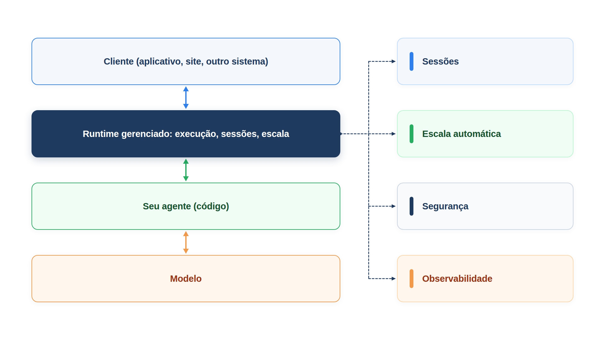

# Capítulo 37 — Deploy gerenciado

O agente foi construído, protegido, avaliado e acompanhado, mas ainda vive em scripts. Para atender o público, ele precisa ser um *serviço*: algo que recebe pedidos pela rede, mantém a conversa de cada cliente, respeita limites de tempo e de uso e aguenta muitos clientes ao mesmo tempo. Neste capítulo, você constrói um serviço mínimo, vê quais responsabilidades ele exige e conhece as ofertas gerenciadas que as assumem. O deploy gerenciado é a camada final: só faz sentido depois de saber o que você está delegando.



> **Antes de começar — PydanticAI neste capítulo**
>
> Neste capítulo você usa `Agent`, `.run`, `.output`, `message_history` e `.override`. Se algum deles não for familiar, revise o [Capítulo 0.4](../modulo-00/0.4-o-primeiro-agente-por-dentro.md) (`Agent`, `.output`) e o [Capítulo 0.5](../modulo-00/0.5-mensagens-e-testes-sem-api.md) (mensagens, `message_history` e modelos simulados). `ModelMessagesTypeAdapter`, `.validate_json` e `.dump_json` aparecem como no [Capítulo 10](../modulo-03/10-arquitetura-de-memoria.md); `.run` é a versão assíncrona de `.run_sync`, e por isso é chamada com `await`.

## O que um serviço de agente precisa

Um agente que atende pela rede precisa resolver, no mínimo, cinco problemas:

- **Sessões:** guardar a conversa de cada cliente entre uma mensagem e outra, e recarregá-la.
- **Limites:** impedir que uma execução consuma recursos sem fim, com um tempo máximo e um teto de chamadas ao modelo (Capítulo 3).
- **Concorrência:** aguentar muitos clientes simultâneos sem esgotar o provedor do modelo, e recusar com elegância quando passar do limite.
- **Segurança:** autenticar quem chama e validar o que chega.
- **Resiliência e observabilidade:** sobreviver a quedas (Capítulo 35) e deixar rastros (Capítulo 34).

Vamos construir os quatro primeiros em poucas linhas, com o Starlette, um *framework* leve para serviços web em Python.

## Um serviço mínimo

*servico.py*

```python
import asyncio
import uuid
from pathlib import Path

from starlette.applications import Starlette
from starlette.requests import Request
from starlette.responses import JSONResponse
from starlette.routing import Route

from pydantic_ai import Agent, ModelMessagesTypeAdapter
from pydantic_ai.usage import UsageLimits

from config import MODELO

agente = Agent(
    MODELO,
    name="atendente",
    instructions="Você atende clientes da Casa Verde em até duas frases.",
)


def criar_app(pasta_de_sessoes: Path, chave_de_api: str, tempo_maximo: float = 20.0, simultaneas: int = 8) -> Starlette:
    pasta_de_sessoes.mkdir(parents=True, exist_ok=True)
    vagas = asyncio.Semaphore(simultaneas)

    def caminho(conversa: str) -> Path:
        return pasta_de_sessoes / f"{conversa}.json"

    async def saude(request: Request) -> JSONResponse:
        return JSONResponse({"status": "ok"})

    async def enviar_mensagem(request: Request) -> JSONResponse:
        id_da_requisicao = str(uuid.uuid4())[:8]
        if request.headers.get("x-api-key") != chave_de_api:
            return JSONResponse({"erro": "não autorizado"}, status_code=401)

        try:
            texto = (await request.json())["texto"]
            conversa = request.path_params["conversa"]
            if not isinstance(texto, str) or not texto.strip() or not conversa.isalnum():
                raise ValueError
        except (ValueError, KeyError, TypeError):
            return JSONResponse({"erro": "corpo inválido"}, status_code=400)

        if vagas.locked():
            return JSONResponse({"erro": "sistema ocupado, tente de novo"}, status_code=429)

        async with vagas:
            arquivo = caminho(conversa)
            historico = ModelMessagesTypeAdapter.validate_json(arquivo.read_bytes()) if arquivo.exists() else None
            try:
                resultado = await asyncio.wait_for(
                    agente.run(texto, message_history=historico, usage_limits=UsageLimits(request_limit=10)),
                    timeout=tempo_maximo,
                )
            except asyncio.TimeoutError:
                return JSONResponse({"erro": "tempo esgotado", "id": id_da_requisicao}, status_code=504)
            arquivo.write_bytes(ModelMessagesTypeAdapter.dump_json(resultado.all_messages()))

        return JSONResponse({
            "resposta": resultado.output,
            "mensagens_na_conversa": len(resultado.all_messages()),
            "chamadas_ao_modelo": resultado.usage.requests,
            "id": id_da_requisicao,
        })

    return Starlette(routes=[
        Route("/saude", saude),
        Route("/conversas/{conversa}/mensagens", enviar_mensagem, methods=["POST"]),
    ])
```

A função `criar_app` monta o serviço com dois endereços: `GET /saude`, para que a infraestrutura saiba que o serviço está vivo, e `POST /conversas/{conversa}/mensagens`, que recebe uma mensagem de um cliente. Siga o caminho de uma mensagem:

1. **Autenticação.** Confere o cabeçalho `x-api-key`. Sem a chave, responde 401. Em produção, use um mecanismo de identidade mais forte, mas o princípio é o mesmo: *o sistema* decide quem é o chamador, como no Capítulo 28.
2. **Validação.** Lê o corpo e confere que o texto é uma `str` não vazia e que o identificador da conversa tem só letras e números (o que impede que um identificador como `../outro` escape da pasta de sessões). Se algo falha, responde 400.
3. **Concorrência.** O `asyncio.Semaphore` limita as execuções simultâneas. Se não há vaga (`vagas.locked()`), responde 429, *Too Many Requests*, e o cliente tenta de novo mais tarde. É melhor recusar com clareza do que degradar todo mundo.
4. **Sessão.** Carrega o histórico da conversa do arquivo, se existir, como no Capítulo 10, e o passa ao agente.
5. **Limites.** Executa o agente com `wait_for(..., timeout=tempo_maximo)` e `UsageLimits(request_limit=10)`. Se o tempo esgota, responde 504, *Gateway Timeout*.
6. **Gravação.** Salva o histórico atualizado e responde com o texto, o número de mensagens da conversa, as chamadas ao modelo e um identificador de requisição, que permite relacionar a resposta ao rastro.

Para exercitar o serviço sem rede, usamos o `TestClient` do Starlette, que chama a aplicação diretamente. O modelo é simulado.

*servico_demo.py*

```python
import tempfile
from pathlib import Path

from starlette.testclient import TestClient

import modelos_simulados as sim
import servico

CHAVE = "segredo-de-teste"
app = servico.criar_app(Path(tempfile.mkdtemp()), CHAVE, tempo_maximo=0.2)
cliente = TestClient(app)
cabecalho = {"x-api-key": CHAVE}

print("GET /saude ->", cliente.get("/saude").json())

with servico.agente.override(model=sim.texto("Seu pedido 1001 foi enviado.")):
    r = cliente.post("/conversas/lia1/mensagens", json={"texto": "Onde está o pedido 1001?"}, headers=cabecalho)
    print("1ª mensagem ->", r.status_code, {k: r.json()[k] for k in ("resposta", "mensagens_na_conversa")})

    r = cliente.post("/conversas/lia1/mensagens", json={"texto": "E a previsão?"}, headers=cabecalho)
    print("2ª mensagem ->", r.status_code, {k: r.json()[k] for k in ("resposta", "mensagens_na_conversa")})

    r = cliente.post("/conversas/lia1/mensagens", json={"texto": "oi"})
    print("sem chave   ->", r.status_code, r.json())

    r = cliente.post("/conversas/lia1/mensagens", json={"texto": "   "}, headers=cabecalho)
    print("corpo vazio ->", r.status_code, r.json())

with servico.agente.override(model=sim.texto("devagar", espera=1.0)):
    r = cliente.post("/conversas/lia2/mensagens", json={"texto": "Olá"}, headers=cabecalho)
    print("modelo lento ->", r.status_code, r.json()["erro"])
```

Saída:

```text
GET /saude -> {'status': 'ok'}
1ª mensagem -> 200 {'resposta': 'Seu pedido 1001 foi enviado.', 'mensagens_na_conversa': 2}
2ª mensagem -> 200 {'resposta': 'Seu pedido 1001 foi enviado.', 'mensagens_na_conversa': 4}
sem chave   -> 401 {'erro': 'não autorizado'}
corpo vazio -> 400 {'erro': 'corpo inválido'}
modelo lento -> 504 tempo esgotado
```

Cada linha confirma uma das responsabilidades. A conversa `lia1` cresceu de 2 para 4 mensagens entre as duas chamadas: a **sessão** foi recarregada. Sem chave, 401; corpo vazio, 400; e com um modelo que leva um segundo e um tempo máximo de 0,2 s, 504: o **limite** protegeu o serviço.

Para colocar o serviço no ar, você o executa com um servidor ASGI, como o Uvicorn (`uvicorn servico:app`), atrás de um balanceador. Ainda faltam peças de produção: a máscara de dados pessoais nos registros (Capítulo 34), os guardrails (Capítulo 27) e a execução durável para fluxos longos (Capítulo 35), além de armazenamento de sessões em um banco, e não em arquivos locais, para poder ter mais de uma instância do serviço.

> **Nota:** Este serviço é um exemplo didático. O armazenamento em arquivos funciona com uma única instância; com várias, as sessões precisam de um armazenamento compartilhado, como um banco de dados. O mesmo vale para o limite de concorrência, que é por processo.

> **Armadilha:** `UsageLimits(request_limit=10)` não devolve uma resposta curta quando o teto é atingido: ele **lança** a exceção `UsageLimitExceeded`. No serviço acima, só `asyncio.TimeoutError` é tratada, então um agente em laço faria o Starlette responder 500 (erro interno). Veja a exceção acontecer, offline, com um modelo simulado que pede a mesma ferramenta para sempre.

*limite_de_uso_demo.py*

```python
from pydantic_ai import Agent, ModelResponse, ToolCallPart
from pydantic_ai.exceptions import UsageLimitExceeded
from pydantic_ai.models.function import AgentInfo, FunctionModel
from pydantic_ai.usage import UsageLimits


async def modelo_em_laco(mensagens, info: AgentInfo) -> ModelResponse:
    return ModelResponse(parts=[ToolCallPart("consultar", {})])


agente = Agent(FunctionModel(modelo_em_laco))


@agente.tool_plain
def consultar() -> str:
    return "sem novidades"


try:
    agente.run_sync("Onde está o pedido?", usage_limits=UsageLimits(request_limit=3))
except UsageLimitExceeded as erro:
    print(type(erro).__name__)
    print(erro)
```

Saída:

```text
UsageLimitExceeded
The next request would exceed the request_limit of 3. Consider raising the limit, or see the docs on usage limits for budget-aware patterns: https://pydantic.dev/docs/ai/core-concepts/agent/#usage-limits
```

O limite é conferido *antes* de cada chamada ao modelo: com `request_limit=3`, a quarta é barrada. Para o serviço, o ajuste é capturar `UsageLimitExceeded` ao lado do `TimeoutError` e responder com um código próprio, como você pensará no exercício 37.1.

### Faça você mesmo

- **37.1 Teto de chamadas:** altere o modelo simulado para chamar uma ferramenta em laço e confira que o `UsageLimits` interrompe a execução. Que código de resposta o serviço devolve hoje, e qual seria melhor?
- **37.2 Identificador malicioso:** envie uma mensagem à conversa `..` e a `a/b`. Descreva o que a validação faz e por que ela importa.
- **37.3 Rastro por requisição:** associe o `id_da_requisicao` ao rastro do Capítulo 34 e escreva como você acharia o rastro de uma resposta específica.
- **37.4 Sessões em banco:** descreva, em prosa, como você trocaria os arquivos por uma tabela de banco, com a conversa serializada em uma coluna, e o que mudaria na concorrência.
- **37.5 Limite por cliente:** acrescente um limite de mensagens por minuto por conversa. Onde guardaria o contador e o que responderia ao exceder?

## Runtimes gerenciados: o que você delega

Escrever e operar o seu próprio serviço dá controle total, e traz o trabalho de manter sessões, escala, segurança e implantação. Os grandes fornecedores oferecem **runtimes gerenciados** que assumem parte desse trabalho. Vale conhecer três.

**Claude Agent SDK, da Anthropic.** É uma biblioteca, em Python e TypeScript, que traz o laço de agente, as ferramentas e o gerenciamento de contexto que movem o Claude Code, para você embutir em sua aplicação, em um processo que *você* opera. Entre as capacidades estão as ferramentas embutidas (ler e editar arquivos, executar comandos, buscar na web), os ganchos (*hooks*) para código próprio em pontos do ciclo de vida, os subagentes, o MCP, as permissões (quais ferramentas rodam sozinhas e quais exigem aprovação), as sessões (manter o contexto, retomar ou bifurcar depois) e os *skills* e comandos. Para quem não quer operar o agente, a Anthropic oferece o **Managed Agents**: um arnês de agente hospedado, que roda o laço, com sessões em um ambiente isolado na nuvem da Anthropic ou em uma infraestrutura própria sua.

**Gemini Enterprise Agent Platform, do Google Cloud** (o Vertex AI Agent Builder e o Agent Engine). É uma plataforma para construir, implantar e gerenciar agentes empresariais, com um *runtime* gerenciado que executa os agentes sem você cuidar da infraestrutura, escala automática, segurança integrada em camadas e APIs REST. Os agentes podem ser construídos com o Agent Development Kit, que você viu no Capítulo 21, e com SDKs em várias linguagens.

**Amazon Bedrock AgentCore, da AWS.** É uma infraestrutura própria para implantar e operar agentes em escala, independente de *framework* e de modelo, o que significa que você pode levar o agente escrito com o seu framework favorito. As peças são: um *runtime* sem servidor para hospedar agentes (*Runtime*), um portal para integrar ferramentas compatíveis com MCP (*Gateway*), a memória gerenciada (*Memory*, do Capítulo 10), a identidade do agente (*Identity*), a observabilidade com rastreamento distribuído (*Observability*), as avaliações de qualidade (*Evaluations*) e o controle de acesso por política (*Policy*).

Os três se parecem por um motivo: cada um empacota as responsabilidades que você acabou de ver, runtime, sessões, escala, segurança, observabilidade e avaliação, em um produto.

## Construir ou delegar?

A decisão não é "gerenciado é melhor": é *o que você quer possuir*. Alguns critérios:

| Critério | Mais a seu favor construir | Mais a favor de delegar |
| --- | --- | --- |
| Controle e personalização | exigências específicas de dados, rede ou conformidade | exigências comuns, atendidas pelo produto |
| Esforço de operação | equipe com experiência em operar serviços | equipe pequena, que quer focar no agente |
| Escala e picos | tráfego previsível e modesto | tráfego variável, com picos |
| Dependência do fornecedor | quer a liberdade de trocar de nuvem ou de modelo | aceita a dependência em troca da conveniência |
| Segurança e auditoria | já tem controles próprios maduros | prefere os controles integrados |
| Tempo até o lançamento | pode investir | precisa lançar logo |

Duas observações. Primeiro, **a arquitetura do agente é independente da hospedagem**: tudo o que você aprendeu neste livro (instruções, ferramentas, memória, guardrails, avaliações) vale nos dois caminhos. Se você mantém o agente em código portátil, a hospedagem é uma decisão reversível. Segundo, seguindo a escada do Capítulo 4, **comece pelo mais simples que resolva**: um serviço mínimo como o deste capítulo atende muito bem um piloto, e a migração para um runtime gerenciado entra quando a escala, a segurança ou a equipe pedirem.

Dentro do PydanticAI, esse espírito se vê nas integrações de execução durável: o mesmo agente roda em Temporal, DBOS, Prefect, Restate ou AWS Lambda, e a escolha é do ambiente em que você opera.

### Faça você mesmo

- **37.6 Seu critério:** preencha a tabela de critérios para a Casa Verde, escolhendo um lado em cada linha, com uma justificativa de uma frase. Qual é a sua decisão para o piloto? E para o ano seguinte?
- **37.7 Portabilidade:** liste três partes do atendente da Casa Verde que migrariam sem alteração para outro ambiente (por exemplo, as ferramentas e as instruções) e três que dependem do ambiente (por exemplo, o armazenamento de sessões e a autenticação).
- **37.8 O que o runtime não faz:** mesmo em um runtime gerenciado, há responsabilidades que continuam com você. Cite quatro (pense em instruções, ferramentas, guardrails, avaliação e custo).

## Recapitulando

Você agora sabe transformar o agente em um serviço, com autenticação, validação, sessões, limite de concorrência, tempo máximo e teto de chamadas, e sabe testá-lo sem rede. Conhece três runtimes gerenciados, o Claude Agent SDK e o Managed Agents, o Gemini Enterprise Agent Platform e o Amazon Bedrock AgentCore, e o critério para decidir entre construir e delegar: o que você quer possuir. E sabe que a arquitetura do agente é a mesma nos dois caminhos.

## Fechando o livro

Dez módulos atrás, a pergunta era o que distingue um agente de um chatbot. Agora você percorreu a resposta inteira. Um agente é um ciclo em que o modelo decide, com instruções, ferramentas e memória (Módulos 1 a 4). Você aprendeu a dar a ele conhecimento, por meio de prompts, RAG e ajuste fino (Módulo 5); a estruturá-lo, de um agente isolado a equipes que colaboram e se comunicam por protocolos abertos (Módulos 6 e 7); a contê-lo, com guardrails, risco por ferramenta e pessoas no ciclo (Módulo 8); a medi-lo, com tarefas, trajetórias e juízes calibrados (Módulo 9); e a operá-lo, com rastros, execução durável, avaliação contínua e deploy (Módulo 10).

Se houver uma lição que atravesse todos eles, é a da escada do Capítulo 4: comece pelo mais simples que resolva o problema e só acrescente autonomia, complexidade e custo quando a evidência, medida por avaliações que você mesmo escreveu, pedir. Agentes que substituem trabalho humano não são os mais autônomos: são os que a equipe consegue entender, medir, conter e melhorar.

### Fontes do capítulo

- Anthropic — [Claude Agent SDK](https://docs.claude.com/en/docs/agent-sdk/overview): o SDK como biblioteca com o laço de agente e as ferramentas do Claude Code; capacidades (ferramentas embutidas, ganchos, subagentes, MCP, permissões, sessões, skills); o Managed Agents como arnês hospedado.
- Google — [Vertex AI Agent Builder / Agent Engine](https://cloud.google.com/vertex-ai/generative-ai/docs/agent-builder/overview): plataforma de agentes com runtime gerenciado, escalabilidade automática, segurança integrada e APIs REST.
- AWS — [Well-Architected Agentic AI Lens](https://docs.aws.amazon.com/wellarchitected/latest/agentic-ai-lens/agentic-ai-lens.html): o Amazon Bedrock AgentCore (Runtime, Gateway, Memory, Identity, Observability, Evaluations e Policy), independente de framework e de modelo.
- Documentação do PydanticAI: *Durable Execution* e *Persistência*.
